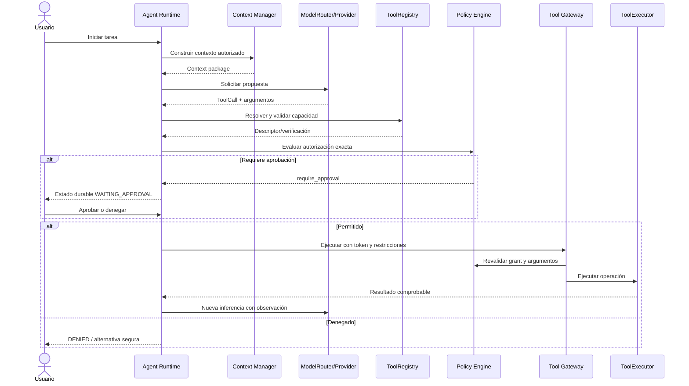
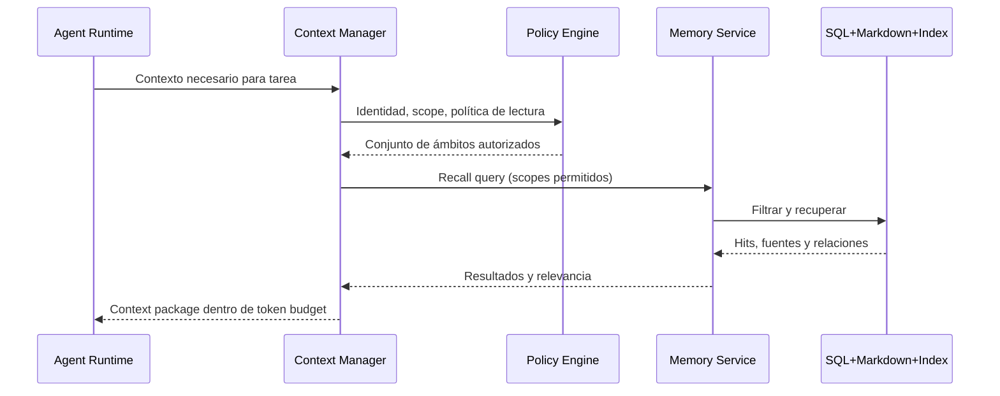
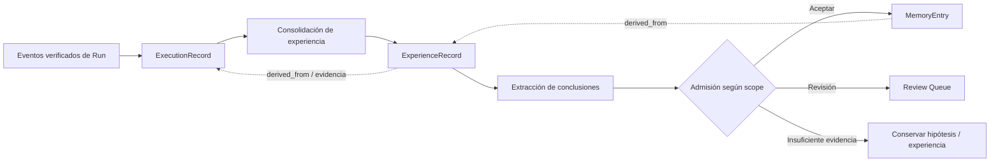

# Flujos de extremo a extremo

Estos flujos describen el **diseño objetivo**; las notas «PoC» indican solo la parte que ya se ha probado.

## A. Petición y llamada a herramienta

**PoC 0.3.1 observada:** ChatGPT propuso `text.transform`, después `filesystem.write`. Hubo dos permisos independientes. En otra ejecución, se denegó `filesystem.write` y no apareció `workspace/denegado-v3.md`.

## B. Memoria y recuperación

**No implementado todavía**: la PoC solo agrega historial compacto de tool observations al prompt. No usa `MemoryService`.

## C. Almacenamiento de experiencia

Distinguir hecho observado, hipótesis, procedimiento probado y mera sugerencia. El sistema no reentrena el LLM por guardar experiencias.

## D. Recuperación tras interrupción

1. Persistir plan, estado y propuesta antes de pedir autorización.
2. Reanudar desde checkpoint identificando operación pendiente, ID del descriptor y hash de argumentos.
3. Verificar nuevamente registro, versión, ámbito y grant.
4. Para efecto externo en estado incierto, conciliar resultados con el mundo real antes de reintentar.
5. Continuar desde observación confirmada o detenerse con estado explícito.

**PoC:** checkpoints de LangGraph restauran interrupciones de aprobación entre procesos; no hay conciliación general de efectos irreversibles.

## E. Fallback de modelo sin fuga de datos

Modelo falla → runtime identifica paso y efectos previos → router propone alternativas compatibles → Policy Engine comprueba clasificación/egreso y costos → usuario aprueba cuando corresponda → nuevo modelo reanuda desde contexto seguro. Si el usuario fijó modelo, no reemplazarlo silenciosamente.

**PoC:** no se implementa fallback automático del modelo fijado. Es una garantía útil de los ensayos, no el motor de recuperación final.
