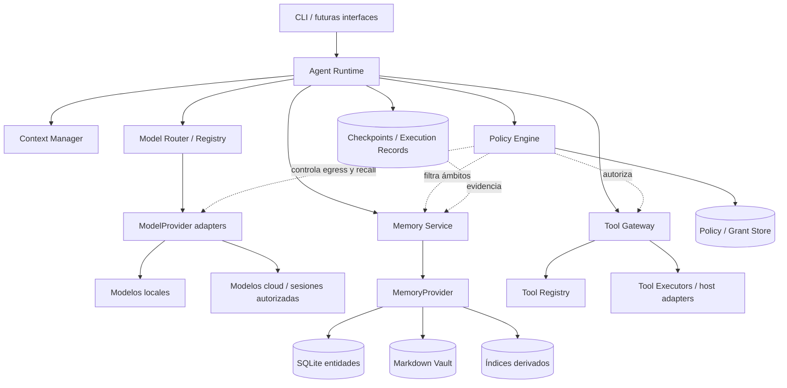

# Arquitectura del sistema

**Versión de referencia:** conceptual v0.4 y diseño técnico de componentes v0.1/v0.2.  
**Topología inicial:** monolito local modular, no microservicios. Las interfaces distinguen responsabilidades; la implementación puede vivir en un proceso.

## Vista de componentes

## Reglas de dependencia

| Módulo | Responsable de | No debe hacer |
|---|---|---|
| Agent Runtime | Ciclo de vida, plan, checkpoints, presupuesto, orquestación | Conceder permisos solo porque lo pida el LLM |
| Context Manager | Seleccionar mensajes, memorias y observaciones para una inferencia | Ser almacenamiento de memoria persistente |
| ModelRegistry | Descubrir identidad, modalidad, límites y capacidades de modelos | Etiquetar subjetivamente «mejor para X» como capacidad objetiva |
| ModelRouter | Resolver selección explícita o automática autorizada | Filtrar privacidad después de enviar datos; cambiar modelo fijado silenciosamente |
| ModelProvider | Adaptar inferencia, tool-call estructurado, streaming y resultados | Ejecutar herramientas; almacenar memoria; administrar permisos |
| MemoryService / Provider | Admission, almacenamiento, relaciones, versión, recall y eliminación | Sustituir checkpoints; tomar instrucciones de texto recuperado |
| ToolRegistry / Provider | Describir, descubrir y ejecutar capacidades confiables | Confundir herramienta instalada con herramienta autorizada |
| Tool Gateway | Validación y mediación antes de cada efecto | Saltarse policy al reanudar o reintentar |
| Policy Engine | Evaluación de reglas, grants, riesgos, scopes, egress | Ejecutar la operación; confiar en argumentos no validados |
| Stores de runtime | Guardar estado operacional y resultados verificables | Convertirse en memoria de conocimiento sin admisión |

## Fronteras de confianza

1. **Entrada de usuario:** puede expresar intención, no parámetros de seguridad arbitrarios. El runtime establece `userId`, `scopeId`, `runId` y el contexto operativo.
2. **Salida del LLM:** no confiable para ejecución. Debe parsearse, validar esquema, resolver identificador registrado y pasar por autorización. Tool calling es una *propuesta*.
3. **Contenido externo y resultados de herramientas:** son datos, no instrucciones con autoridad. No pueden cambiar el Policy Engine.
4. **Egreso a cloud:** transmitir prompt, documentos y resultados a un modelo remoto es una operación sobre datos que requiere política previa.
5. **Adaptadores host:** se encargan de garantizar límites efectivos de filesystem, red, procesos y plataforma. Las etiquetas del manifiesto no sustituyen la verificación.
6. **Persistencia:** separar transacciones de conocimiento, registros de ejecución, credenciales y checkpoints. Los secretos no se incluyen en prompts ni en la memoria ordinaria.

## Desarrollo y despliegue

La portabilidad se consigue mediante contratos y adaptadores, no construyendo sincronización o servicios distribuidos desde el primer día. SQLite inicial y Markdown pueden seguir funcionando en otros sistemas. Los adaptadores del entorno (`Hyprland`, PowerShell, etc.) se seleccionarán por capacidades disponibles, sin que el planner dependa de comandos específicos.

## Degradación elegante

Distinguir `unavailable` de `unsupported` y de `policy_denied`. Una alternativa solo puede elegirse si ofrece capacidad equivalente y respeta privacidad, costo, consentimiento y estado de efectos. Ante ausencia de opción válida, detener/informar con error estructurado. **Nunca fallar en abierto**.

## Correspondencia con las PoC

- `src/graph.ts` y `src/policy.ts`: primer corte de estado/aprobación/escritura controlada.
- `src/v2/{registry,policy,tools,graph}.ts`: registro, grants por ámbito, autorización y operaciones confiables.
- `src/v3/{graph,models,router,chatgpt-inference,chatgpt-auth}.ts`: loop con planner real, checkpoints de LangGraph, modelo mock y OAuth ChatGPT.

Estos son **cortes funcionales**: no implementan todavía MemoryService, Context Manager completo, router por capacidades/métricas ni el Policy Engine transversal del diseño de referencia.

**Fuentes:** planificación, líneas 8182–9500, 9505–9913 y 12972–13693; inspección del archivo de código de PoC 0.3.1.
