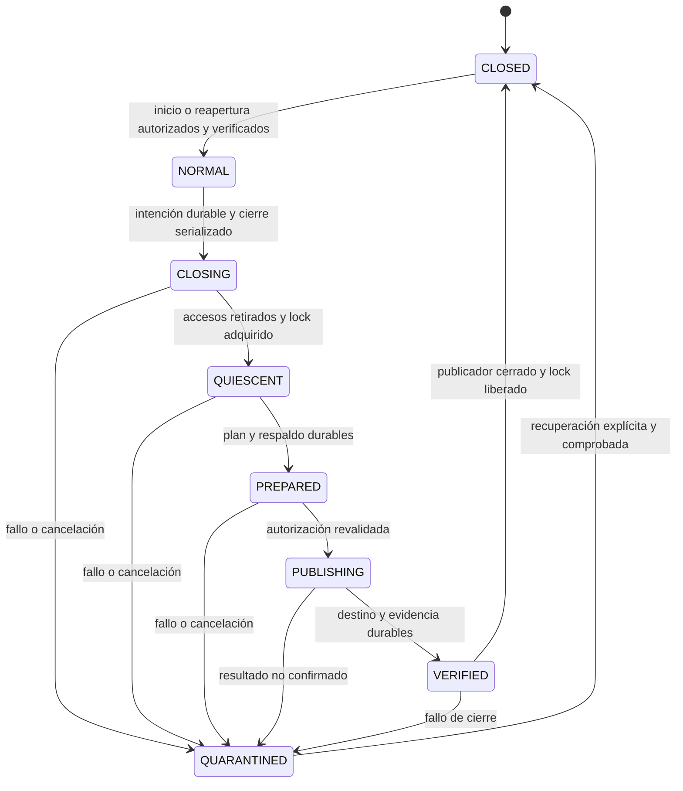

# ADR-088 — Contrato portable del Maintenance Backend

**Estado:** aceptada arquitectónicamente por confirmación explícita del responsable posterior al merge del PR #8; no implementada. La aprobación no autoriza operaciones sobre datos reales. La futura implementación debe comenzar por M1, protocolo portable sin privilegios OS prematuros; queda fuera del encargo actual del Gateway. Procedencia y separación de alcances en el [registro de revisión](087-increment-1-approval.md).

El cuerpo conserva la redacción de la propuesta revisada; esta actualización registra su aceptación y restricciones, sin cambiar el contrato técnico ni acreditar capacidades implementadas.

**Fecha:** 27-10-2026. **Base inspeccionada:** `origin/main` en `5aa4eac`; ADR-088 no existía en esa base.

**Relación:** desarrolla la dependencia de mantenimiento del Incremento 2 de [ADR-087](087-tool-gateway-input-contract.md), también propuesta. Conserva ADR-001/014/019/021/051/055/058/061/063/066/067/072 y los contratos aceptados de [ADR-085](085-runtime-failures-and-recovery.md) y [ADR-086](086-durable-invocations-and-recovery.md).

**Documentos complementarios:** [investigación, amenazas y alternativas](../architecture/maintenance-backend-analysis.md), [plan incremental y pruebas](../delivery/maintenance-backend-plan.md).

## Problema y alcance

Una operación administrativa puede invalidar autorizaciones o cambiar los archivos que un ejecutor ya abrió. El lock SQLite actual serializa mutantes v3 que lo adquieren; no excluye v1/v2, administradores del registro/grants, procesos no cooperativos ni accesos directos al almacenamiento. Tampoco existe una transacción conjunta entre manifiestos, grants, checkpoints y efectos externos.

Se propone una autoridad de mantenimiento capaz de impedir nuevas admisiones, retirar accesos existentes, validar el conjunto de datos y publicar una operación exacta con evidencia durable. Su contrato es portable; cada adaptador debe demostrar las mismas propiedades en un perfil de instalación concreto. Tener Linux, cgroup v2, permisos de propietario o un servicio detenido no demuestra por sí solo esas propiedades.

El primer consumidor sería la sustitución de **un** descriptor registrado v1 por v2 prevista en ADR-087. «Migración de grants» significa conservar los grants asociados a la huella antigua, identificarlos y poder revocarlos explícitamente; **no** convertirlos en autorizaciones de la huella nueva. El backend no es un ejecutor de shell ni una API general de reparación de bases. Otras operaciones críticas necesitarán su propio contrato versionado y plan de recuperación antes de habilitarse.

Este PR contiene exclusivamente documentación. La aprobación de un contrato arquitectónico y la autorización de una operación sobre una instalación son actos diferentes; ninguno se presume por crear o integrar este PR. No iniciar implementación sin aprobación explícita.

## Base existente y compatibilidad

| Fuente | Garantía existente que se conserva | Brecha que aborda la propuesta |
|---|---|---|
| ADR-085, aceptada | `completed` exige evidencia para runs nuevos; incertidumbre suspende; recuperación explícita y acotada | Detener procesos puede dejar trabajo incierto; mantenimiento no lo convierte en terminal ni lo reconcilia |
| ADR-086, aceptada e implementada | Ledger separado, reclamación antes del Executor, resultado durable, lock global v3, máximo dos recuperaciones por run | Lock cooperativo y local; no controla procesos históricos ni toda administración |
| ADR-087, propuesta | Huellas legado conservadas; consentimiento nuevo para descriptor distinto; todos los runs terminales para migrar | Necesita una frontera comprobable de acceso, admisión y recuperación del mantenimiento |
| ADR-001/055/067, baseline | Core y políticas independientes del SO | Sesiones y errores comunes; cgroups, tokens, ACL y handles permanecen en adaptadores |

No se modifica ADR-085/086 ni el significado de `recover`, `migrate`, `stateVersion: 2`, del esquema del ledger, de los hashes o de los grants. Se propone añadir un plano administrativo separado, con versión propia. Las ampliaciones propuestas respecto del texto de ADR-087 son: autoridad exclusiva de publicación, journal administrativo y ancla de generación separados, autorización específica para parada/aplicación/reapertura, inventario verificable y protocolo de recuperación. Justificación: un recibo de sesión, un lock liberado al morir o un rename exitoso no bastan para recuperar de forma segura. No se flexibiliza su exclusión ni su condición de terminalidad.

## Decisión propuesta

Adoptar un **Maintenance Backend** que mantenga la frontera de exclusión durante toda la operación y sea el único que pueda publicar cambios administrativos. Separar cuatro responsabilidades:

1. **Coordinador portable:** valida el contrato de la operación, construye el plan, evalúa precondiciones y presenta resultados normalizados. No recibe privilegios del host ni handles de escritura arbitrarios.
2. **Autoridad de mantenimiento:** autentica al administrador, serializa sesiones por instalación, mantiene admisión y generación, registra evidencia y controla al publicador confiable.
3. **Adaptador de plataforma/almacenamiento:** impone acceso y ciclo de vida, verifica identidades reales, sincroniza y reemplaza recursos con semántica acreditada. Expone evidencia, no un booleano aportado por el CLI.
4. **Adaptadores de inventario y operación:** interpretan versiones conocidas de stores y calculan cambios acotados. No ejecutan plugins suministrados por un manifiesto o por el LLM.

La implementación podrá agrupar autoridad y publicador en un proceso pequeño confiable. Separarlos en procesos exige demostrar igualmente el control de sus descendientes, handles y muerte. La API no permite callbacks arbitrarios con acceso privilegiado ni entrega una ruta escribible como sustituto de una sesión.

## Modelo de confianza y garantías

La base de confianza comprende kernel, almacenamiento dentro del perfil probado, administrador privilegiado del host, configuración protegida, supervisor/autoridad, publicador e intérpretes de formatos. Un proceso de runtime puede ignorar locks, conservar archivos abiertos, bifurcarse o intentar salir del contenedor; no se confía en su cooperación. No se promete resistir a root/Administrator, kernel o supervisor comprometidos, ni a dispositivos que mienten sobre flush. Esos límites no excusan aceptar accesos de usuarios ordinarios fuera de la frontera.

La garantía es condicional: **si** todas las vías de acceso pertenecen a la frontera acreditada, la admisión se mantiene cerrada y se prueba la retirada de los accesos anteriores, solo la autoridad/publicador de la sesión vigente puede mutar los recursos autorizados. No se deduce de una exploración puntual del host. La [matriz de amenazas](../architecture/maintenance-backend-analysis.md#modelo-de-amenazas) identifica premisas, controles, pruebas y límites.

La exclusión tampoco demuestra autenticidad retrospectiva de registros que un proceso con escritura legítima pudo falsificar antes de la sesión. La interpretación de terminalidad presupone registros producidos por componentes confiables bajo el perfil admitido; ante indicios de manipulación se rechaza. Si se requiere resistir además a escritores arbitrarios que falsifican la historia operacional, habrá que mediar esa persistencia con una autoridad confiable o evidencia autenticada independiente antes de habilitar la operación. Un hash calculado al entrar no resuelve ese problema.

| ID | Invariante propuesta | Evidencia exigible |
|---|---|---|
| G1 | Una sola autoridad/sesión mutante por instalación y generación | Serialización externa al worker; segundo propietario rechazado; no sucesión mientras sobreviva el anterior |
| G2 | Ningún ejecutor nuevo o antiguo accede durante mantenimiento | Frontera histórica de almacenamiento y admisión cerrada para CLI, servicios, schedulers, consultas y administración |
| G3 | Sin accesos anteriores utilizables al publicar | Contención desde el nacimiento, subárbol vacío, ausencia de delegaciones externas y drenaje de I/O según perfil |
| G4 | Cada publicación corresponde al plan autorizado y a los mismos recursos | Identidad de instalación/stores, generación, huellas y permiso revalidados en la autoridad de escritura |
| G5 | No se publica sin evidencia previa durable; éxito requiere evidencia posterior | Intento/plan, respaldo, resultado y comprobación persistidos; fallo mantiene cierre |
| G6 | No se transfiere autorización ni se resuelve incertidumbre por mantenimiento | Grants antiguos intactos salvo revocación separada; cero cambios retrospectivos de invocaciones/checkpoints |
| G7 | Caída, cancelación, estado desconocido o pérdida de autoridad no reabren admisión | Arranque cerrado, recuperación explícita, sin desbloqueo por TTL ni `finally` |
| G8 | Mismo contrato en todas las plataformas; capacidades insuficientes deniegan | Perfil de conformidad y suite por adaptador; `unsupported` no se convierte en modo inseguro |

## Contrato agnóstico del sistema operativo

Los nombres siguientes son un contrato lógico propuesto, no API existente ni tipos definitivos. `maintenance/1` versiona el protocolo con independencia del run y del descriptor.

### Datos y autoridad

| Objeto | Contenido mínimo y semántica |
|---|---|
| `BackendCapabilities` | Versión del protocolo, ID/versión del adaptador y perfil validado, operaciones y versiones admitidas, pruebas de acceso/admisión/quiescencia/durabilidad disponibles, razones de no disponibilidad. Declararse capaz no sustituye la comprobación de la instalación |
| `InstallationBinding` | ID protegido de instalación, generación de aprovisionamiento, identidad de raíz/volumen, inventario completo de stores/registro/sidecars, identidades lógicas conocidas y esquema esperado. No se deriva solo del pathname |
| `MaintenancePlan` | ID de operación y versión, instalación, recursos exactos, huellas origen/destino, digest del contenido a publicar, cambios/restricciones, grants afectados por clave completa, precondiciones, estrategia de recuperación y autorización de interrupción requerida |
| `MaintenanceAuthorization` | Principal autenticado por canal confiable, rol/policy y su versión, acción, ID/digest del plan, instalación/generación, nonce de uso único y vigencia. No acepta identidad declarada por el modelo ni usa grants de herramientas |
| `MaintenanceSession` | Referencia opaca del backend, generación, operación/plan, identidad no reutilizable del publicador y referencias de evidencia. No es un bearer token exportable que habilite acceso directo a archivos |
| `MaintenanceEvidence` | Secuencia, vínculo a plan/autorización/sesión, hechos observados y su origen, recursos, pre/postcondiciones, decisiones y resultado durable. Separar hechos, inferencias y comprobaciones no disponibles |
| `MaintenanceResult` | `rejected`, `not_applied`, `applied`, `already_applied` o `indeterminate`; código/motivo, referencia de evidencia y estado de admisión. `applied` no significa que el servicio esté reabierto |

El digest del plan usa una representación canónica versionada propia de `maintenance/1`, con vectores fijos. No reutiliza ni cambia la canonicalización de argumentos de ADR-087. Cada acción nueva se autentica; expiración o revocación bloquean nuevos pasos mutantes, pero no prueban la muerte del propietario ni deshacen una escritura ya aceptada.

### Operaciones

| Operación lógica | Precondición y efecto |
|---|---|
| `probe(binding)` | Consulta acotada de soporte/configuración. No emite sesión ni crea stores faltantes |
| `preview(request)` | Plan informativo sobre datos legibles o exportación; marca snapshot y limitaciones. No muta datos activos ni concede exclusión; debe repetirse bajo exclusión |
| `enter(plan, authorization)` | Autoriza interrupción, reserva generación, registra intención, cierra admisión y retira accesos. Solo devuelve sesión utilizable tras comprobar frontera, quiescencia y lock de ADR-086 |
| `validate(session)` | Relee inventario, integridad y precondiciones bajo exclusión. Discrepancia respecto al plan exige rechazo o plan/consentimiento nuevos |
| `apply(session, plan, authorization)` | La autoridad vuelve a validar identidad, permiso y vigencia, registra intención durable y publica exclusivamente la operación allowlisted. No ejecuta herramientas del run |
| `inspect(operationId)` | Consulta administrativa autenticada por el backend, sin arrancar un runtime con acceso a archivos. No repara ni rellena evidencia ausente |
| `recover(operationId, authorization)` | Nueva sesión exclusiva, elimina cualquier publicador anterior antes de adquirir acceso; concilia únicamente estados administrativos demostrables según la tabla de recuperación |
| `leave(session, authorization)` | Confirma resultado, cierra publicador/handles, libera lock, registra cierre y autoriza reapertura para versiones admitidas. No se ejecuta automáticamente al terminar `apply` |

`enter`, `apply`, `recover` y `leave` admiten IDs de solicitud para deduplicación durable. Repetir el mismo ID con otro contenido se rechaza. Un timeout del cliente significa resultado desconocido hasta consultar; no crea otra operación ni otro permiso. La autorización puede abarcar una secuencia exacta dentro de una sesión; tras una caída se exige autorización explícita de recuperación/reapertura.

### Estados y exclusión

Estos son estados de la instalación, no del run. Todo reinicio empieza cerrado; un journal ausente, restaurado, corrupto o de versión desconocida impide admisión. Un registro histórico `NORMAL` no autoriza por sí solo el arranque tras una sesión interrumpida. El supervisor debe controlar todas las vías de activación, también sockets/timers y arranques manuales bajo la cuenta de servicio.

Orden de adquisición obligatorio: autoridad/generación de instalación → cerrar admisión → terminar/drenar ejecutores → lock v3 → inspección y publicación. Nunca esperar la terminación de un proceso al que se le retiene un lock necesario para salir. El mantenimiento conserva el mismo archivo de control; no lo borra/reemplaza para desbloquearlo. Falta de lock tras vaciar el grupo indica una premisa incumplida y bloquea.

Un contador de generación evita replay dentro del backend; **no** cerca a un proceso antiguo que escribe directamente por un handle. Antes de reemplazar una sesión se retiran y confirman todos sus accesos, incluidos los del publicador anterior. Si el publicador sigue vivo o no puede inspeccionarse, no hay sesión sucesora. En caso de pérdida de comunicación se rechazan nuevas solicitudes; una llamada de sistema ya aceptada puede terminar. Su resultado queda `indeterminate` hasta inspección, con admisión cerrada. No se promete cancelación instantánea de escrituras.

## Condiciones para permitir o rechazar

Aplicar exige la conjunción de G1–G8 y de las precondiciones de la operación. Una comprobación desconocida cuenta como falsa. Los códigos son propuestos para el plano administrativo, sin modificar `OperationError` ni estados aprobados del runtime.

| Condición observada | Decisión |
|---|---|
| Checkout compartido/no administrado, perfil no probado o capacidades insuficientes | `maintenance_exclusion_unavailable`; previsualización informativa posible, aplicación prohibida |
| Falta de permiso, consentimiento exacto, nonce válido o policy vigente | `maintenance_authorization_required` o `maintenance_authorization_stale`; sin publicación |
| Otro mantenimiento, ejecutor sobreviviente, lock ocupado o parada incompleta | `maintenance_busy` o `maintenance_quiescence_unproven`; no robar sesión ni continuar por timeout |
| Datos antes compartidos, alias de acceso, handles externos posibles, inspección insuficiente | `maintenance_boundary_unproven`; no aceptar `chmod`, `ps` ni confirmación manual como prueba |
| Store esperado ausente/ajeno, esquema desconocido, inventario parcial o integridad inconsistente | `maintenance_inventory_invalid`; no crear bases vacías ni tratar ausencia como cero runs |
| Run pendiente/pausado/recuperable, invocación incierta o ejecución/grant ambiguos | `maintenance_nonterminal_runs`; no ejecutar `recover` ni consumir su presupuesto para facilitar la migración |
| Huella origen, grants afectados o destino distintos del plan | `maintenance_plan_stale`; nuevo plan y consentimiento |
| Fallo de evidencia, respaldo, sync, publicación o pérdida de sesión | `maintenance_persistence_failed` o `maintenance_outcome_indeterminate`; cierre conservado |
| Todas las condiciones demostradas | Aplicar una operación exacta, verificar y registrar; reapertura separada |

Para ADR-087 se inspeccionan **todos** los runs de los stores v1/v2/v3 del inventario, no solo el seleccionado. Un adaptador versionado debe demostrar terminalidad con snapshot, tareas/interrupciones y metadatos; `next=[]` aislado no prueba finalización y v1 ni siquiera usa el mismo campo `status`. Los terminales históricos no obtienen evidencia de éxito retrospectiva. En v3, `completed`, `denied`, `failed` y `budget_exhausted` solo son elegibles si no hay contradicciones, tareas pendientes ni invocaciones/grants ambiguos. Un registro huérfano o un formato sin interpretación segura bloquea. Un store nunca usado puede figurar ausente únicamente si el inventario protegido de aprovisionamiento acredita esa ausencia esperada.

## Autorización, auditoría y persistencia de evidencia

La policy administrativa separa inspeccionar, interrumpir servicios, aplicar el plan, revocar grants históricos, recuperar y reabrir. Un permiso del sistema para escribir un archivo no es consentimiento de migración. El consentimiento muestra instalación, cambio de huellas/restricciones, claves de grants afectadas y riesgo de detener runs. La terminación forzada necesita estar explícitamente autorizada; no se añade implícitamente tras un timeout. No hay `--force` que dispense precondiciones.

Se propone un journal operacional administrativo separado del ledger de herramientas y del lock de ADR-086; una implementación inicial podría usar SQLite local con commits durables. La ubicación exacta y esquema deberán fijarse al implementar. La autoridad conserva además un ancla de instalación/generación en almacenamiento protegido fuera del conjunto que una operación puede reemplazar o restaurar. Ambos son inaccesibles para ejecutores y CLI antiguos. No añadir tablas a SqliteSaver ni mantener abierta la transacción del journal durante una operación externa.

El registro contiene: protocolo/adaptador/perfil, instalación y generación, IDs y secuencias de operación, identidad administrativa referenciada, policy/consentimiento, digest del plan, inventario/identidades, evidencia de admisión y quiescencia, clasificación de runs, huellas y digests antes/después, referencias de respaldo, fases, errores normalizados y cierre/reapertura. Instantes ayudan al diagnóstico; orden y autoridad dependen de secuencia/generación, no del reloj. Guardar también rechazos cuando el journal esté disponible.

No almacenar tokens, argumentos completos de herramientas, contenido personal, volcados de `/proc`, credenciales ni logs crudos de providers. Los respaldos son datos operacionales protegidos, no adjuntos de auditoría. Retención: conservar evidencia y respaldo mientras exista una operación no resuelta; no purgar antes de una política explícita de archivo y restauración validada. Acceso y exportación requieren permiso; una exportación sanitizada no habilita escritura.

Una cadena de hashes ayuda a detectar alteraciones respecto de un ancla conservada, pero no hace un log inmutable frente a quien controla ambas. El alcance inicial protege contra usuarios ordinarios y rollback parcial. No se garantiza detectar restauración coordinada de datos, journal y ancla por un administrador privilegiado; tal amenaza requiere anclaje independiente adicional. Si no puede persistirse la intención, no se modifica el recurso de negocio. Si falla el registro posterior, no se comunica éxito: se mantiene la instalación cerrada y se conserva lo ya durable. Un mensaje en stderr no sustituye esa evidencia.

## Publicación, transacciones y recuperación

Se propone atomicidad visible de **un manifiesto** y recuperación por evidencia; no una transacción distribuida. La serialización y el cierre impiden que lectores administrados vean una combinación intermedia. Grants/checkpoints/ledger no se reescriben en la sustitución. Revocar un grant histórico será otra operación autorizada, idempotente y auditable por `(capability, descriptor_hash, scope)`; listar un hash truncado no basta.

Secuencia de publicación para ADR-087:

1. Bajo sesión válida y lock, comprobar inventario, integridad, terminalidad, huella origen y plan. Leer mediante adaptadores de almacenamiento que no inicialicen stores ausentes. La recuperación interna de journals SQLite, si fuese necesaria, debe ocurrir controlada y quedar identificada; una lectura no debe ocultar una reparación.
2. Persistir plan/intención y evidencia previa. Conservar copia íntegra del manifiesto origen fuera del registro activo, con digest y durabilidad acreditados. No mover primero el activo dejando un hueco.
3. Preparar destino validado en staging privado del mismo filesystem; comprobar contenido, propietario y permisos del archivo nuevo. Sincronizar contenido y metadatos necesarios. El backend fija los recursos, no acepta rutas arbitrarias del cliente.
4. Revalidar autoridad y precondiciones, persistir estado preparado y sustituir atómicamente el manifiesto. Sincronizar directorio y releer destino; persistir resultado/evidencia. En Linux, `rename` proporciona reemplazo atómico, pero los handles anteriores siguen referenciando sus objetos y `fsync` del archivo no sincroniza por sí solo la entrada del directorio. Fuentes: [rename](https://man7.org/linux/man-pages/man2/rename.2.html), [fsync](https://man7.org/linux/man-pages/man2/fsync.2.html).
5. Verificar que grants antiguos conservan claves/scope, que no se creó grant para la nueva huella y que los stores ajenos no cambiaron semánticamente. Cerrar publicador/handles, liberar lock y registrar finalización. Solo `leave` autorizado permite volver a admitir ejecutores compatibles.

Durabilidad significa éxito confirmado por el adaptador dentro de su perfil probado de filesystem/VFS/hardware; no inmunidad a corrupción física. SQLite depende de locking y flush correctos y tiene mecanismos propios de commit; eso no incluye un JSON externo. Véanse [atomic commit](https://www.sqlite.org/atomiccommit.html) y [riesgos de corrupción](https://www.sqlite.org/howtocorrupt.html). No se habilitan NFS/SMB, carpetas sincronizadas, volúmenes compartidos multi-host ni filesystems sin semántica acreditada en el primer perfil.

| Evidencia tras interrupción, siempre bajo una nueva exclusión demostrada | Recuperación administrativa permitida |
|---|---|
| Intención durable; origen exacto activo; no publicación confirmada; staging/respaldo coherentes | Registrar `not_applied` tras comprobar todo. Reintentar publicación exige acción explícita y precondiciones vigentes; no reusar silenciosamente el consentimiento |
| Destino exacto activo; journal preparado y respaldo válidos; resultado ausente | Revalidar/sincronizar y registrar `applied` recuperado sin repetir rename ni crear grants |
| Destino y resultado exactos, operación ya confirmada | `already_applied`, sin cambios de negocio; completar cierre explícito pendiente |
| Origen activo pero journal dice aplicado, destino inesperado, backup/identidad ausente o generaciones incompatibles | `indeterminate`, cuarentena y diagnóstico; no elegir el archivo más reciente |
| Estado coherente pero run no terminal tras parada | Rechazar migración. Reapertura del runtime solo con acceso consistente y autorización independiente; su recuperación conserva ADR-085/086 |
| Fallo antes de poder probar retirada del publicador anterior | No inspección mutante ni sesión sucesora; mantener cierre |

No restaurar automáticamente el descriptor antiguo: podría reactivar sus grants. Un rollback deliberado es otra operación con revisión de permisos, evidencia y aprobación; queda fuera del primer consumidor. Tampoco restaurar bases aisladas, borrar WAL/journals o recrear el ledger. Una copia coherente por base no prueba coherencia del conjunto de bases y manifiestos.

Cancelación antes de publicar detiene nuevos pasos y deja resultado verificable; durante publicación puede dejar resultado indeterminado. Ni cancelación ni fallo implican reapertura. Un respaldo recuperable no promete deshacer efectos externos ni el trabajo interrumpido por la parada.

## Adaptadores y límites de portabilidad

Se recomienda evaluar primero un perfil Linux administrado: identidad de servicio sin login, datos privados desde aprovisionamiento, supervisor protegido, contención de todos los procesos y admisión persistente cerrada. cgroup v2 aporta control del subárbol, no control de acceso al almacenamiento. La instalación y privilegios necesarios, prohibición de escape/delegación y verificación de I/O están detallados en el [análisis Linux](../architecture/maintenance-backend-analysis.md#adaptador-linux-propuesto). Ninguna dependencia de cgroups o systemd entra al núcleo portable.

Windows con servicio protegido, ACL y Job Objects es un candidato; macOS/BSD requerirían una frontera equivalente, posiblemente mediante broker de almacenamiento o entorno offline. No se declara soporte de ninguno. Un backend portable que solo inspeccione/planifique y rechace `apply` es válido. Un broker único con datos inaccesibles a clientes puede trasladar la exclusión a solicitudes de almacenamiento, pero exige adaptar los accesos directos actuales y demostrar que no quedan handles antiguos. Comparación y descartes en el [análisis de alternativas](../architecture/maintenance-backend-analysis.md#alternativas-comparadas).

## Consecuencias, riesgos residuales y aprobación

La propuesta añade instalación administrada, autoridad privilegiada pequeña, journal y procedimientos de recuperación. Puede dejar el servicio detenido indefinidamente ante evidencia insuficiente: se prioriza seguridad sobre disponibilidad. Detener correctamente un proceso no confirma sus efectos anteriores; root y restauraciones totales continúan dentro de la base de confianza. La cobertura de procesos no basta si quedan I/O o delegaciones fuera del perfil.

El mantenimiento no convierte el checkout actual en entorno seguro ni proporciona sandbox general para herramientas, exactamente una ejecución, conciliación de efectos, protección multi-host o permisos heredados de descriptores. ADR-087 Incremento 1 puede revisarse e implementarse por separado una vez aprobado; el Incremento 2 permanece bloqueado hasta satisfacer todos los [criterios de desbloqueo](../delivery/maintenance-backend-plan.md#criterios-para-desbloquear-adr-087-incremento-2).

Se solicita revisión explícita de: contrato portable y G1–G8; frontera de confianza y perfil de almacenamiento; autoridad única de publicación; autorización por acciones y fallo cerrado; journal/ancla y recuperación sin rollback automático; y secuencia de implementación/pruebas. Aprobar esta ADR no acredita que ningún adaptador cumpla sus condiciones. La implementación seguirá necesitando la autorización explícita solicitada para el siguiente incremento.
