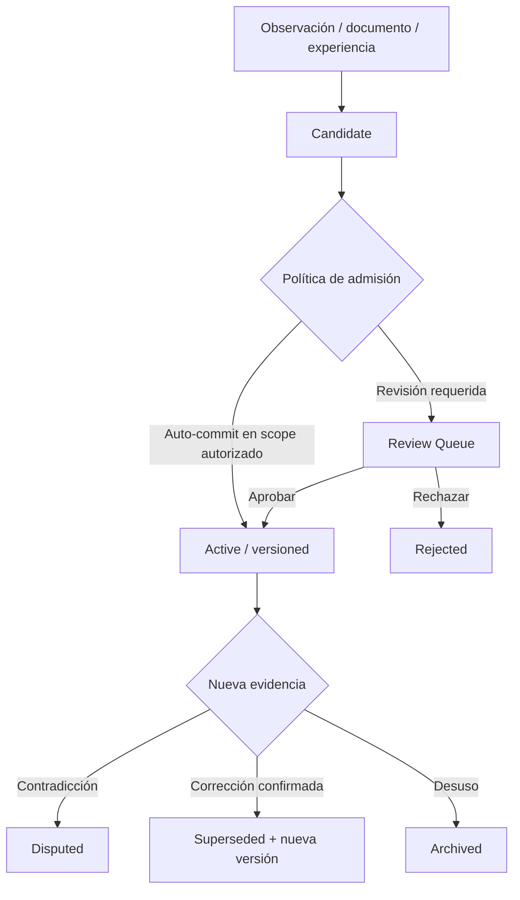

# Especificación: memoria híbrida y aprendizaje operativo

**Diseño:** Memory Management v0.3, MemoryProvider v0.1/v0.2, ADR-003–014 y ADR-038–048. **Estado del código:** subsistema de memoria de conocimiento **pendiente**; las bases SQLite de las PoC son persistencia operacional, no la implementación de este diseño.

## Modelo conceptual

La memoria se diseña como un **Memory Service** compartido entre agentes, con un `MemoryProvider` que desacopla lógica de persistencia y motores de búsqueda. La capa de consulta responde qué sabemos, con qué evidencia, en qué ámbito y con qué vigencia. El agente no modifica registros directamente.

### Tres recursos con responsabilidades distintas

| Entidad | Responde | Contenido | Ejemplo |
|---|---|---|---|
| `ExecutionRecord` | ¿Qué ejecutó técnicamente el sistema? | Solicitudes, herramientas, salidas/resultados y timestamps, bajo retención | Ejecución de `hyprctl` o un comando de verificación |
| `ExperienceRecord` | ¿Qué ocurrió, qué intentamos y qué aprendimos? | Contexto, hipótesis, intentos, fallos, observaciones, desenlace y referencias a evidencia | Diagnóstico de atajos de Hyprland que devolvían `Invalid monitor` |
| `MemoryEntry` | ¿Qué conocimiento reutilizable tenemos? | Entrada concisa, tipada, con origen y validez | Las variables `MONITOR1`–`MONITOR3` requieren IDs válidos en cierta configuración |

Las relaciones como `derived_from` permiten ir de una conclusión a experiencia y evidencia. **Nunca universalizar una experiencia aislada sin corroboración.** Un intento fallido también puede conservarse como experiencia sin volverse conocimiento confirmado.

## MemoryEntry: estructura y estados

```ts
type MemoryType =
  | 'fact' | 'observation' | 'decision' | 'preference'
  | 'hypothesis' | 'procedure' | 'progress' | 'summary';
type MemoryStatus =
  | 'candidate' | 'active' | 'disputed' | 'superseded' | 'archived';
interface MemoryEntry {
  id: string;
  version: number;
  scopeId: string;
  type: MemoryType;
  status: MemoryStatus;
  title: string;
  content: string;
  tags: string[];
  sourceIds: string[];
  createdAt: string;
  updatedAt: string;
  observedAt?: string;
  validUntil?: string;
}
```

La caducidad y la corrección no dependen de borrar la historia: `superseded` preserva cadena de revisiones; `disputed` representa conflicto pendiente. Una fecha de observación no implica vigencia ilimitada.

## Scopes y políticas de admisión

| Ámbito | Regla inicial de escritura |
|---|---|
| Session | Automática y temporal, según retención |
| Project | Automática dentro de proyecto previamente autorizado |
| Personal | Propuesta y revisión |
| Shared Knowledge | Propuesta y aprobación, salvo política explícita |
| Sensitive Data | Restricción especial; no guardar automáticamente |

Estas reglas no permiten a un LLM inventar permisos. Los datos privados no se heredan de un scope a otro por el mero hecho de que una búsqueda sea relevante.

```ts
interface MemoryProposal {
  id: string;
  candidate: MemoryDraft;
  targetScopeId: string;
  reason: string;
  relatedMemoryIds: string[];
  status: 'pending' | 'approved' | 'rejected';
}
```

`MemoryDraft` es un tipo de entrada referenciado en el diseño, no completamente definido allí. La especificación concreta deberá agregar controles de fuente, clasificación, revisión y concurrencia sin presentar esos campos propuestos como ya acordados.

## Persistencia: una fuente canónica lógica

**SQLite** conserva entidades estructuradas, relaciones, scopes, versiones, permisos y metadatos. **Markdown Vault** conserva documentos legibles y portables. No deben editarse de manera independiente dos copias «maestras» de la misma información. Se define un origen canónico **por clase de recurso** y se sincronizan referencias/índices derivados.

```text
MemoryService
  ├─ Structured repository (SQLite)
  │    ├─ MemoryEntry / ExperienceRecord / Relations
  │    ├─ version history / scopes / review queue
  │    └─ document metadata and source references
  ├─ Markdown Vault (canonical documents)
  └─ Derived indexes
       ├─ full-text
       └─ embeddings / semantic index (posterior)
```

Las actualizaciones de un archivo Markdown deben detectar cambio, recomputar índice y verificar integridad. La inconsistencia temporal se resuelve con reconciliación y reparación, no fingiendo una transacción atómica entre SQLite y filesystem. Versionar esquema y respaldar SQL + Vault juntos.

## Contrato del provider

```ts
interface MemoryProvider {
  get(id: string): Promise<OperationResult<MemoryEntry>>;
  search(query: MemoryQuery): Promise<OperationResult<MemorySearchResult>>;
  create(entry: MemoryDraft): Promise<OperationResult<MemoryEntry>>;
  revise(id: string, revision: MemoryRevision): Promise<OperationResult<MemoryEntry>>;
  link(relation: MemoryRelation): Promise<OperationResult<void>>;
  getHistory(id: string): Promise<OperationResult<MemoryVersion[]>>;
  forget(id: string): Promise<OperationResult<void>>;
}
```

**No se especificaron completamente** en la fuente los tipos auxiliares `MemorySearchResult`, `MemoryDraft`, `MemoryRevision`, `MemoryRelation`, `MemoryVersion`. Son puntos abiertos de esquema, no licencia para suponer cualquier forma final. Concurrencia, revisión optimista y conflictos deben resolverse explícitamente.

## Recall: recuperación híbrida

```ts
interface MemoryQuery {
  text: string;
  scopeIds: string[];
  types?: MemoryType[];
  tags?: string[];
  includeRelations?: boolean;
  limit?: number;
  tokenBudget?: number;
}
interface MemoryHit {
  resourceId: string;
  resourceType: 'memory' | 'document';
  title: string;
  excerpt: string;
  relevance: number;
  sourceIds: string[];
  relatedResourceIds: string[];
}
```

**Pipeline normativo:** identificar identidad y ámbitos permitidos → filtrar por autorización **antes** de realizar consulta/expansión → búsqueda estructurada/textual y, opcionalmente, semántica → fusionar y rerankear → expandir relaciones autorizadas → ensamblar contexto dentro de presupuesto → conservar procedencia. No permitir que el reranker «descubra» registros prohibidos. `EmbeddingProvider` es distinto del LLM y registra modelo/versión para reconstrucción de índices.

## Ciclo de vida de información



### Archivar, corregir y eliminar

- `archive`: retirar de recuperación normal, conservar registro.
- `supersede`: una versión nueva sustituye dato anterior manteniendo historia.
- `forget`: eliminar contenido del almacenamiento activo y de índices derivados, conforme a su alcance.
- `purge`: eliminación ampliada sujeta a retención, respaldos y efectos colaterales.

No afirmar que un borrado en base activa garantiza desaparición inmediata de todas las copias de respaldo: especificar política de ciclo de vida y reconstrucción de índices.

## MVP de memoria aprobado conceptualmente

SQLite con migraciones; MemoryEntry tipadas y versionadas; scopes y permisos; tags y relaciones; Markdown Vault; indexación de documentos; búsqueda full-text; review queue; API unificada. **Embeddings/vector search y sincronización entre equipos quedan para etapas posteriores.** El subsistema deberá contemplar `ExperienceRecord` y su relación con evidencias, sin inflar automáticamente cada memoria de conocimiento.

## Pruebas de aceptación del futuro subsistema

- Una memoria fuera del scope autorizado no aparece en resultados ni en expansión relacional.
- Una entrada corregida mantiene procedencia, estados y cadena de versiones; se evita servir la versión obsoleta como actual.
- Reconstruir índices derivados desde SQLite/Markdown canónicos produce búsquedas funcionales.
- Propuesta personal permanece pendiente hasta aprobación; la misma acción dentro de un scope autorizado puede tener otro flujo.
- Una experiencia fallida puede recuperarse como experiencia, no como conclusión universal.
- `forget` retira entradas e índices correspondientes según política documentada.
- Exportar y restaurar SQL + Vault conserva identidad, relaciones y fuentes.

**Fuentes:** conversación original, líneas 8443–9158, 10682–11570; corrección ADR-048 en 11415–11555.
