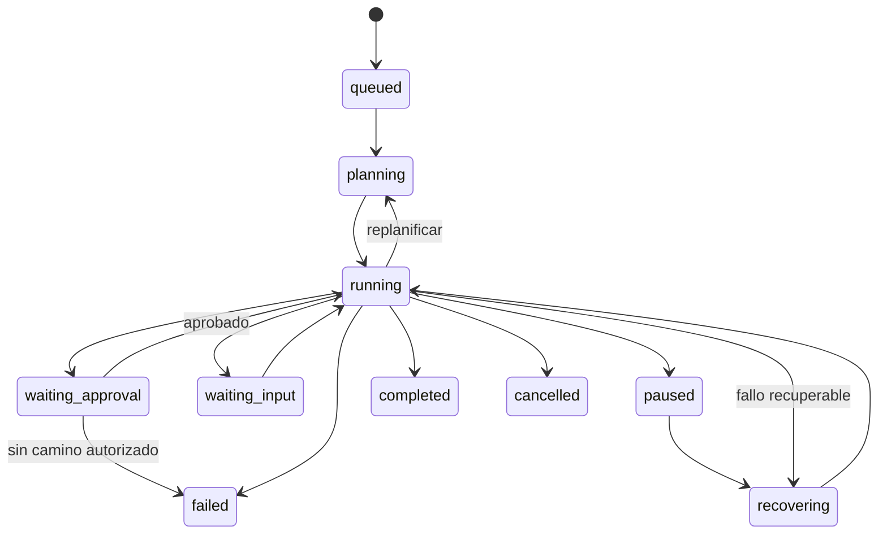

# Especificación: Agent Runtime y ejecución durable

**Diseño:** Agent Runtime v0.1 (ADR-073–084), separado de proveedores de inferencia. **Implementado parcialmente:** LangGraph + SQLite checkpoint en PoC 0.3.1.

## Responsabilidad

Orquestar peticiones, planes incrementales, inferencias, herramientas, permisos, presupuestos, estados, checkpoints y recuperación. El LLM no controla estados ni concede permisos y no puede dar una operación por ejecutada sin observación verificable.

## Entidades independientes

| Entidad | Significado |
|---|---|
| `Session` | Interacción conversacional, puede alojar múltiples tareas |
| `Run` | Tarea concreta con objetivo, estado y límites |
| `Step` | Operación o decisión verificable en un plan; dependencias y resultado |
| `ToolInvocation` | Intento de efecto controlado con identidad y estado propios |
| `Checkpoint` | Instantánea/estado de continuación, no una memoria de conocimiento |

## Máquina de estados objetivo



Estados conceptuales documentados: `queued`, `planning`, `running`, `waiting_approval`, `waiting_input`, `paused`, `recovering`, `completed`, `failed`, `cancelled`. La denegación puede representarse con estado explícito (`DENIED` en PoC) aunque no figure como estado terminal separado en el diagrama conceptual v0.1; la máquina final deberá reconciliar y versionar ambos vocabularios.

**Regla:** `completed` solo cuando se satisfacen criterios de éxito comprobables; un texto «listo» del LLM no lo acredita.

## Planificación incremental

```ts
interface TaskPlan {
  id: string;
  runId: string;
  version: number;
  objective: string;
  successCriteria: SuccessCriterion[];
  steps: TaskStep[];
}
interface TaskStep {
  id: string;
  description: string;
  dependencies: string[];
  requiredCapabilities: string[];
  status: 'pending' | 'running' | 'completed' | 'failed' | 'skipped';
}
```

El plan puede revisarse cuando la evidencia cambia. Toda replanificación debe incrementar versión y preservar pasos completados, autorizar efectos nuevos y no realizar de nuevo operaciones irreversibles. `SuccessCriterion` requiere formalización posterior; en la PoC el verificador se limita a outputs y tests concretos.

## Persistencia y recuperación

```ts
interface AgentRun {
  id: string;
  sessionId: string;
  agentId: string;
  scopeId: string;
  objective: string;
  planVersion: number;
  status: RunStatus;
  currentStepId?: string;
  modelSelection: ModelSelection;
  budget: ExecutionBudget;
  createdAt: string;
  updatedAt: string;
}
```

Un checkpoint debe contener posición segura del workflow, plan vigente, resultados ya confirmados, autorizaciones pendientes y referencias a observaciones. No copiar dentro del checkpoint toda la memoria documental. Versionar esquema de checkpoint y validar compatibilidad al recuperar después de despliegues.

### Invocaciones y efectos inciertos

```ts
interface ToolInvocation {
  id: string;
  runId: string;
  stepId: string;
  capabilityId: string;
  argumentsHash: string;
  idempotencyKey?: string;
  status: 'prepared' | 'authorized' | 'executing' | 'succeeded' | 'failed' | 'uncertain';
}
```

**Escenario crítico:** el Executor escribe el archivo y cae antes de confirmar el resultado. Si el runtime reintenta ingenuamente, duplica o sobrescribe. Reconciliar con el estado real antes de repetir una acción. Para lecturas puede reintentar con límites; para escrituras idempotentes verificar precondiciones; para acciones irreversibles/ambiguas marcar `uncertain` y requerir decisión. No afirmar garantía universal de *exactly once*.

## Aprobaciones durables

Preparar propuesta → schema validate → checkpoint → Policy Engine → interrupción `waiting_approval` → validación exacta de respuesta/huella/grant → ejecución controlada → observación/checkpoint → nueva inferencia. Si la decisión es negativa, terminar o replantear **solo** si hay una alternativa autorizada; jamás eludir con otra herramienta.

La decisión debe poder resolverse desde CLI hoy, y potencialmente web/notificación mañana; el estado y la autoridad permanecen en el runtime, no en la interfaz.

## Presupuestos

```ts
interface ExecutionBudget {
  maxSteps: number;
  maxModelCalls: number;
  maxToolCalls: number;
  maxDurationMs: number;
  maxEstimatedCost?: number;
}
```

Controlar duración, loops de herramientas, costo y estancamiento. Un presupuesto agotado resulta en parada trazable, no en intentar más acciones de forma encubierta.

## Context Manager

Construye paquetes de contexto con instrucciones, conversación, memorias autorizadas y tool observations. Reserva tokens de salida y recupera conocimiento según relevancia. No confundir: una ventana de contexto no es memoria persistente; un checkpoint no es un ExperienceRecord. Las observaciones son contenido no confiable.

## Aprendizaje al cierre

Consolidar evidencias de ejecución en un `ExperienceRecord` propuesto y derivar `MemoryEntry` solo bajo políticas de admisión y respaldo suficiente. El resultado puede ser fallo o incertidumbre: también es experiencia útil.

## Multiagente

El runtime debe admitir identificación de agentes y futura delegación dentro de las mismas políticas. **No construir multiagente paralelo en el MVP** ni introducir plataforma/orquestador externo. ADR-084 es extensibilidad, no prueba de funcionamiento actual.

## Corte actual de la PoC

`src/v3/graph.ts`: LangGraph persiste estado con `SqliteSaver` (`data/runtime-v3.sqlite`), planifica una herramienta por inferencia, revalida descriptor/hash, utiliza `interrupt` para aprobación y continúa después de `approve`. Límite actual `MAX_TOOL_CALLS = 5`. El `mock` prueba regresión, y `chatgpt` ya produjo propuestas reales de dos herramientas. No hay todavía `TaskPlan` general con dependencias, compensación de efectos complejos ni Context Manager completo.

**Fuentes:** conversación original, líneas 12972–13693; código PoC 0.3.1 e informes de sus tests.
