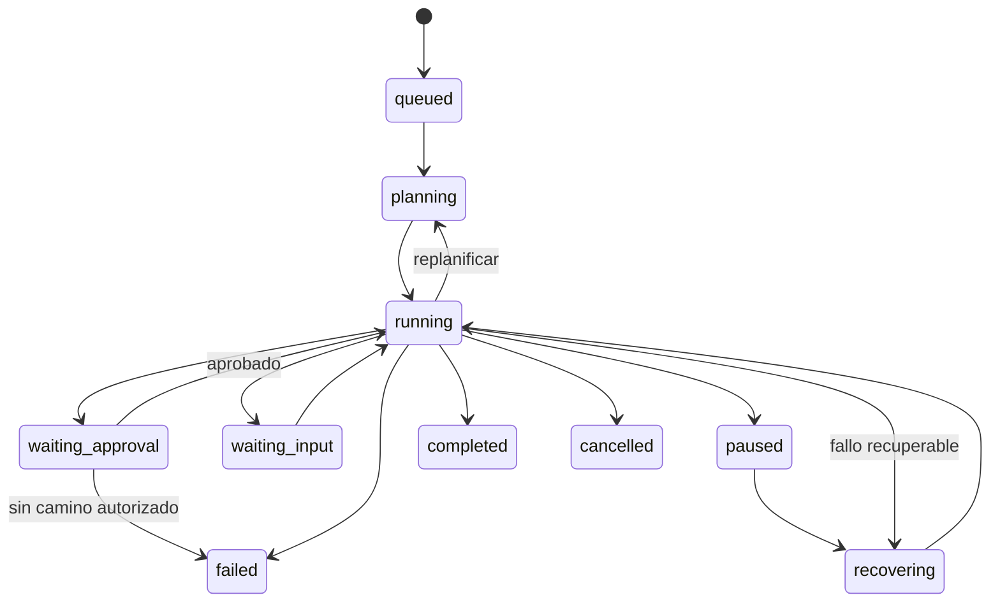

# Especificación: Agent Runtime y ejecución durable

**Diseño:** Agent Runtime v0.1 (ADR-073–084), separado de proveedores de inferencia. **Implementado parcialmente:** LangGraph + SQLite checkpoint en PoC 0.3.1.

## Consolidación aprobada — ADR-085

[ADR-085](../decisions/085-runtime-failures-and-recovery.md) formaliza fallos, recuperación, incertidumbre y compatibilidad. **Aceptada; implementación incremental.** `completed` exige verificación del objetivo: una respuesta final del modelo solo activa el verificador.

[ADR-086](../decisions/086-durable-invocations-and-recovery.md), **aceptada e implementada**, concreta el registro durable de invocaciones, exclusión de comandos y migración conservadora. El modelo/verificador pueden recuperarse explícitamente; el Executor no se reintenta. La conciliación de efectos inciertos permanece pendiente.

### Contrato de objetivo implementado en v3

```ts
interface ObjectiveCriterion {
  id: 'objective-file';
  kind: 'workspace.file_content';
  version: 1;
  fileName: string;          // basename Markdown seguro del workspace
  expectedContent: string;   // UTF-8, máximo 16 KiB
}
```

El solicitante define un criterio antes de iniciar mediante `--expect-file` y `--expect-content`. No se deriva del texto libre del modelo. Un hash lo vincula al run, objetivo y ámbito; los nodos de propuesta, autorización, ejecución y comprobación verifican esa vinculación. Los checkpoints nuevos contienen `stateVersion: 2`, criterio/hash, evidencia, identidad del ledger, siguiente fase segura y contador de recuperación. El criterio conserva su versión 1.

El verificador resuelve `filesystem.read`, aplica la policy actual y realiza una lectura real y acotada. No acepta rutas arbitrarias, symlinks ni archivos no regulares. Los resultados son `passed`, `failed` o `inconclusive`, con motivo, fecha, hash de criterio y huella del descriptor. Una lectura completa dentro del límite incluye hash de contenido y tamaño observado; la evidencia no duplica el texto.

- Coincidencia exacta: `completed`, sin operación pendiente ni autorización activa.
- Archivo inexistente, contenido distinto o target no regular: `failed`.
- Denegación de lectura por policy: `denied`.
- Comprobación inconclusa: `paused`; solo errores de lectura transitorios reconocidos habilitan recuperación.

`retry-verification` requiere una interrupción real en `verification_recovery`, identidad/hash coincidentes y presupuesto disponible. Persiste `recovering` y el contador antes de leer otra vez. Máximo dos recuperaciones por run, compartidas con modelo y reparaciones de continuidad; necesitar una tercera termina en `failed`. No vuelve al modelo ni al Executor. Un resultado negativo no activa reparación automática.

Los checkpoints legados siguen consultables: `completed` v0 sin evidencia se etiqueta como no verificado; v1 con evidencia conserva su significado. Su continuación se bloquea hasta una migración explícita segura. Este incremento verifica un resultado de archivo; no prueba objetivos arbitrarios ni requisitos sobre qué herramientas debieron usarse.

### Errores, invocaciones y recuperación implementados

| Situación | Estado durable / siguiente acción |
|---|---|
| Error conocido recuperable de inferencia | `paused`, error normalizado y `model_recovery`; solo `recover` vuelve al mismo proveedor |
| Propuesta inválida o error de modelo no recuperable | `failed`; ninguna autorización ni ejecución |
| Policy denegada o grant revocado antes del efecto | `denied` |
| Fallo probado antes de efectos del Executor | `failed`; sin retry del Executor |
| Executor iniciado sin resultado durable | Invocación `uncertain`, run `paused`, `retryable:false`; conciliación pendiente |
| Resultado confirmado, checkpoint incompleto | `recover` restaura una observación por invocation ID; no vuelve al Executor |
| Grant fallido o no confirmado después del resultado | Resultado conservado; `paused`, sin retry automático de grant ni herramienta |
| Persistencia necesaria no disponible | Error de infraestructura; detener, sin afirmar que se guardó un estado nuevo |

`runtime-operations.sqlite` mantiene esquema propio v1 e identidad UUID, vinculada a checkpoints v2. La identidad del run fija criterio y proveedor. Cada invocación usa `(runId, ordinal)` y vincula descriptor, solicitud, scope y criterio. Se reclama con transacción breve antes del Executor; el resultado se confirma antes del grant y del checkpoint. Las observaciones se deduplican por invocation ID.

`runtime-control.sqlite` mantiene una transacción `BEGIN IMMEDIATE` durante cada comando mutante v3. Otro mutante, incluso de otro run, recibe `Runtime busy`; `status` consulta sin recuperar. La muerte del proceso libera el lock SQLite; no borrar el archivo de control. Los tres stores deben permanecer juntos en almacenamiento local; no se acredita recuperación multi-host ni restauración desde copias incoherentes.

La fachada revalida el checkpoint más reciente bajo exclusión y usa durabilidad síncrona de LangGraph. `invoke(null)` no recupera ejecuciones activas; los terminales son consultables sin reabrirse. Una orden `recover --request-id` se registra antes del despacho y consume presupuesto durable. Repetir un ID ya despachado no hace otro intento. Una interrupción antes del despacho puede retomar la misma orden sin consumir de nuevo; si ya fue despachada, se requiere otra orden y presupuesto disponible. No hay retries automáticos configurados en los SDK ni fallback comercial.

Si la interrupción ocurrió antes de reclamar el Executor, `recover` restaura una aprobación nueva, incluso si existía un grant. La recuperación no concede consentimiento. Si falta el ledger vinculado, tiene identidad diferente o se perdió el checkpoint de un run registrado, se bloquea la continuación; no recrear historia vacía.

### Compatibilidad y migración implementadas

`migrate` acepta únicamente una interrupción real de aprobación v0/v1 sin autorización activa ni error ambiguo, o una interrupción recuperable de verificación v1. v0 requiere criterio explícito. v1 conserva criterio, contador y evidencia. La adaptación agrega un checkpoint v2 sin borrar el historial; repetirla es idempotente y una aprobación migrada exige consentimiento nuevo.

Los terminales antiguos se consultan sin migrarlos; `authorized` + `execute` antiguo no demuestra ausencia de efectos y se rechaza. También se rechazan versiones desconocidas y checkpoints con errores ambiguos. Estas reglas no constituyen una migración universal ni conciliación de efectos externos.

## Responsabilidad

Orquestar peticiones, planes incrementales, inferencias, herramientas, permisos, presupuestos, estados, checkpoints y recuperación. El LLM no controla estados ni concede permisos y no puede dar una operación por ejecutada sin observación verificable.

## Entidades independientes

| Entidad | Significado |
|---|---|
| `Session` | Interacción conversacional, puede alojar múltiples tareas |
| `Run` | Tarea concreta con objetivo, estado y límites |
| `Step` | Operación o decisión verificable en un plan; dependencias y resultado |
| `ToolInvocation` | Intento de efecto controlado con identidad y estado propios |
| `Checkpoint` | Instantánea/estado de continuación, no una memoria de conocimiento |

## Máquina de estados objetivo



Estados conceptuales documentados: `queued`, `planning`, `running`, `waiting_approval`, `waiting_input`, `paused`, `recovering`, `completed`, `failed`, `cancelled`. La denegación puede representarse con estado explícito (`DENIED` en PoC) aunque no figure como estado terminal separado en el diagrama conceptual v0.1; la máquina final deberá reconciliar y versionar ambos vocabularios.

**Regla:** `completed` solo cuando se satisfacen criterios de éxito comprobables; un texto «listo» del LLM no lo acredita.

## Planificación incremental

```ts
interface TaskPlan {
  id: string;
  runId: string;
  version: number;
  objective: string;
  successCriteria: SuccessCriterion[];
  steps: TaskStep[];
}
interface TaskStep {
  id: string;
  description: string;
  dependencies: string[];
  requiredCapabilities: string[];
  status: 'pending' | 'running' | 'completed' | 'failed' | 'skipped';
}
```

El plan puede revisarse cuando la evidencia cambia. Toda replanificación debe incrementar versión y preservar pasos completados, autorizar efectos nuevos y no realizar de nuevo operaciones irreversibles. `SuccessCriterion` requiere formalización posterior; en la PoC el verificador se limita a outputs y tests concretos.

## Persistencia y recuperación

```ts
interface AgentRun {
  id: string;
  sessionId: string;
  agentId: string;
  scopeId: string;
  objective: string;
  planVersion: number;
  status: RunStatus;
  currentStepId?: string;
  modelSelection: ModelSelection;
  budget: ExecutionBudget;
  createdAt: string;
  updatedAt: string;
}
```

Un checkpoint debe contener posición segura del workflow, plan vigente, resultados ya confirmados, autorizaciones pendientes y referencias a observaciones. No copiar dentro del checkpoint toda la memoria documental. Versionar esquema de checkpoint y validar compatibilidad al recuperar después de despliegues.

### Invocaciones y efectos inciertos

```ts
interface ToolInvocation {
  id: string;
  runId: string;
  stepId: string;
  capabilityId: string;
  argumentsHash: string;
  idempotencyKey?: string;
  status: 'prepared' | 'authorized' | 'executing' | 'succeeded' | 'failed' | 'uncertain';
}
```

**Escenario crítico:** el Executor escribe el archivo y cae antes de confirmar el resultado. Si el runtime reintenta ingenuamente, duplica o sobrescribe. Reconciliar con el estado real antes de repetir una acción. Para lecturas puede reintentar con límites; para escrituras idempotentes verificar precondiciones; para acciones irreversibles/ambiguas marcar `uncertain` y requerir decisión. No afirmar garantía universal de *exactly once*.

## Aprobaciones durables

Preparar propuesta → schema validate → checkpoint → Policy Engine → interrupción `waiting_approval` → validación exacta de respuesta/huella/grant → ejecución controlada → observación/checkpoint → nueva inferencia. Si la decisión es negativa, terminar o replantear **solo** si hay una alternativa autorizada; jamás eludir con otra herramienta.

La decisión debe poder resolverse desde CLI hoy, y potencialmente web/notificación mañana; el estado y la autoridad permanecen en el runtime, no en la interfaz.

## Presupuestos

```ts
interface ExecutionBudget {
  maxSteps: number;
  maxModelCalls: number;
  maxToolCalls: number;
  maxDurationMs: number;
  maxEstimatedCost?: number;
}
```

Controlar duración, loops de herramientas, costo y estancamiento. Un presupuesto agotado resulta en parada trazable, no en intentar más acciones de forma encubierta.

## Context Manager

Construye paquetes de contexto con instrucciones, conversación, memorias autorizadas y tool observations. Reserva tokens de salida y recupera conocimiento según relevancia. No confundir: una ventana de contexto no es memoria persistente; un checkpoint no es un ExperienceRecord. Las observaciones son contenido no confiable.

## Aprendizaje al cierre

Consolidar evidencias de ejecución en un `ExperienceRecord` propuesto y derivar `MemoryEntry` solo bajo políticas de admisión y respaldo suficiente. El resultado puede ser fallo o incertidumbre: también es experiencia útil.

## Multiagente

El runtime debe admitir identificación de agentes y futura delegación dentro de las mismas políticas. **No construir multiagente paralelo en el MVP** ni introducir plataforma/orquestador externo. ADR-084 es extensibilidad, no prueba de funcionamiento actual.

## Corte histórico de la PoC 0.3.1

`src/v3/graph.ts`: LangGraph persiste estado con `SqliteSaver` (`data/runtime-v3.sqlite`), planifica una herramienta por inferencia, revalida descriptor/hash, utiliza `interrupt` para aprobación y continúa después de `approve`. Límite actual `MAX_TOOL_CALLS = 5`. El `mock` prueba regresión, y `chatgpt` ya produjo propuestas reales de dos herramientas. No hay todavía `TaskPlan` general con dependencias, compensación de efectos complejos ni Context Manager completo.

**Fuentes:** conversación original, líneas 12972–13693; código PoC 0.3.1 e informes de sus tests.
