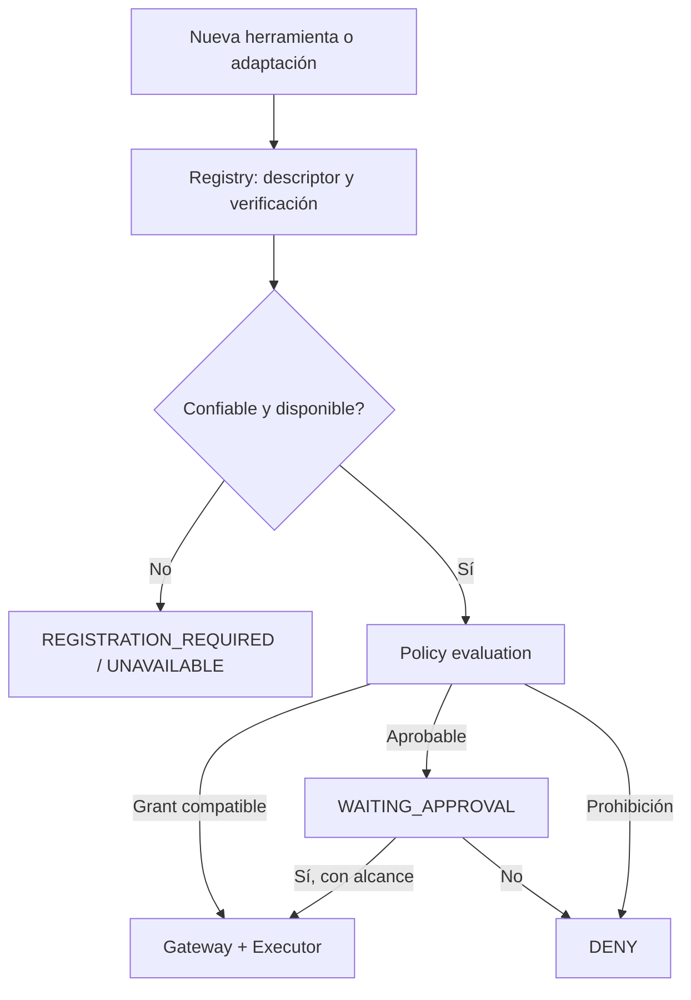

# Especificación: capacidades, registro y ejecución de herramientas

**Diseño:** ToolProvider v0.1 (ADR-049–057), ampliado por descubrimiento dinámico de permisos (ADR-068–072). **Implementación parcial:** PoC 0.2–0.3.1.

## Objetivo

Que un agente pida **capacidades semánticas** (`filesystem.read`, `media.video.transcode`, `desktop.window.focus`), no que necesite razonar en términos de `hyprctl`, PowerShell, `ffmpeg` o shell. Los adaptadores concretos implementan operaciones por plataforma.

## Registro frente a ejecución

| Componente | Responsabilidad |
|---|---|
| `ToolRegistry` | Descubrir e inscribir descriptores y versiones disponibles; verificar que se pueden confiar los adaptadores |
| `ToolProvider` | Enumerar, describir y resolver capacidades bajo contratos uniformes |
| `ToolGateway` | Punto obligatorio antes de todo efecto; comprueba schema, identidad, autorización y límites |
| `ToolExecutor` | Invocar una implementación validada con recursos y permisos efectivos delimitados |
| `Policy Engine` | Decide si el uso es permitido, requiere aprobación, registro o denegación |

**Invariante:** ni un LLM ni un nuevo binario en `PATH` se convierten automáticamente en ejecutor privilegiado. «Registrada», «disponible», «confiable» y «autorizada» son cuatro propiedades distintas.

## Descriptor y contratos

```ts
interface ToolDescriptor {
  id: string;
  version: string;
  description: string;
  inputSchema: JsonSchema;
  outputSchema: JsonSchema;
  effects: Array<'read' | 'write' | 'execute' | 'external'>;
  availability: Availability;
}
```

Ejemplo planificado de capacidad específica:

```ts
// filesystem.read
interface ReadFileInput { path: string; encoding?: 'utf8' | 'base64'; }
interface ReadFileOutput { content: string; size: number; modifiedAt: string; }
```

Estas declaraciones son diseños de interfaz, no permisos. `JsonSchema` no queda definido exhaustivamente en la conversación original. Los errores de ejecución utilizan `OperationResult` compartido.

## Descubrimiento y aprobación bajo demanda



Si se instala FFmpeg, un adaptador validado podría exponer `media.video.transcode`. Si nunca se autorizó, el sistema solicita permiso delimitado a un directorio de origen y de destino, sin red ni privilegios. Un grant de workspace permite **esa capacidad y esas restricciones**, no la ejecución de cualquier comando del programa.

## Nuevas versiones e incremento de efectos

El registro conserva ID, versión, esquema, efectos y huella de descriptor/implementación. Si un upgrade añade escritura o red a una herramienta previamente autorizada para lectura, el grant anterior **no amplía privilegios**. Hay que reevaluar conformidad y, si procede, pedir autorización adicional. Una herramienta no puede declararse `read-only` sin controles del adaptador que garanticen esa semántica.

## Ejecución de comandos genéricos

El diseño prefiere capacidades específicas en lugar de un shell libre. Si se incorpora ejecución de procesos, usar contrato restrictivo:

```ts
interface ProcessExecutionRequest {
  executable: string;
  args: string[];
  workingDirectory: string;
  timeoutMs: number;
  maxOutputBytes: number;
}
```

Verificar binario, argumentos, carpeta, acceso a red, permisos del host, tiempo, output y clasificación de datos. Una cadena arbitraria `bash -c "..."` no es equivalente a una capacidad estructurada. Una política de herramienta específica no debe ser eludible llamando al shell.

## Auditoría y relación con memoria

Cada invocación genera resultados técnicos (`ExecutionRecord`) y referencias trazables. Al cerrar una tarea, el sistema podrá sintetizar `ExperienceRecord`, conservando hipótesis/intentos/resultados y datos de procedencia. Esta fase debe respetar redacción de secretos y límites de retención; no copiar salidas sensibles indiscriminadamente.

## PoC actual y sus límites

- `src/v2/registry.ts`: registra descriptores por ID, versión y fingerprint; no carga arbitrariamente plugins ejecutables.
- `src/v2/tools.ts`: `filesystem.read`, `filesystem.write`, `text.transform`, validadas sobre workspace seguro de `.md`.
- `src/v2/policy.ts`: grants por ámbito, hash de solicitud y validación de aprobación.
- `src/v3/graph.ts`: tool-call propuesto, verificación previa/posterior y autorización antes de ejecutar.
- No existe soporte general para FFmpeg, Hyprland, Git, navegador o shell confiable. Los ejemplos de esas capacidades son requisitos de diseño futuro.

**Fuentes:** conversación original, líneas 11587–11990 y 12659–12945; código PoC v0.2/v0.3.1.
